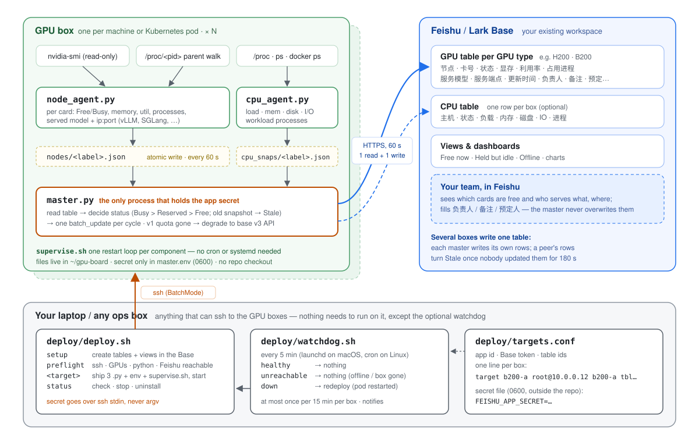
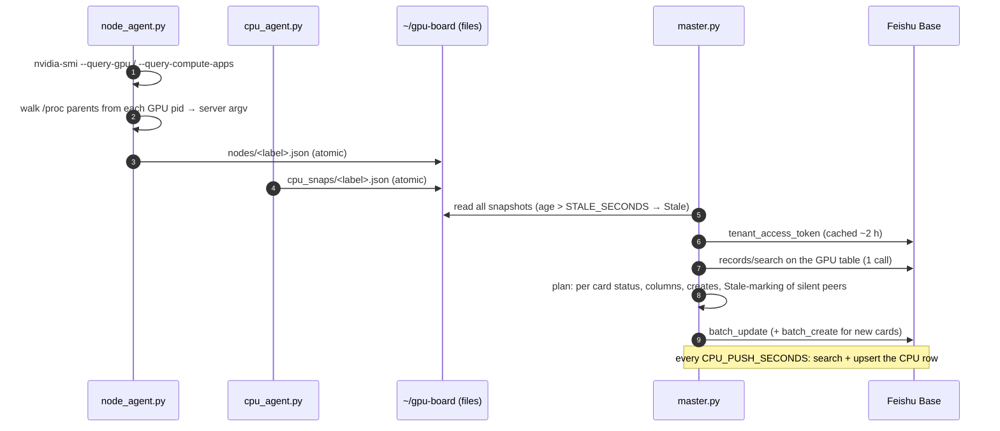

# Architecture

**English** | [简体中文](architecture.zh-CN.md)

This document explains how the board works and why it is built this way. For
setup steps, see the [README](../README.md).



## Contents

1. [Components](#components)
2. [One cycle, end to end](#one-cycle-end-to-end)
3. [Status rules](#status-rules)
4. [Served-model detection](#served-model-detection)
5. [Several boxes, one table](#several-boxes-one-table)
6. [Feishu API and quota](#feishu-api-and-quota)
7. [Lifecycle: supervise, deploy, watchdog](#lifecycle-supervise-deploy-watchdog)
8. [Security model](#security-model)
9. [Why this design](#why-this-design)
10. [Other topologies](#other-topologies)

## Components

| Where | File | Role |
|---|---|---|
| every GPU box | `board/node_agent.py` | Per-card snapshot from `nvidia-smi`, plus the served model and endpoint found by walking `/proc`. Writes `nodes/<label>.json`. No network, no credentials. |
| every GPU box | `board/cpu_agent.py` | Per-host snapshot: load and 1-hour peak, memory %, disk %, busiest-disk I/O %, docker container count, workload processes. Writes `cpu_snaps/<label>.json`. No network, no credentials. |
| every GPU box | `board/master.py` | Reads the snapshots and the table, decides each card's status, and writes the table in one batch. The only component with the app secret. |
| every GPU box | `supervise.sh` (generated) | One restart loop per component, plus hourly log trimming. Stands in for cron and systemd, which pods usually lack. |
| your laptop | `deploy/deploy.sh` | `setup` / `preflight` / deploy / `status` / `check` / `stop` / `uninstall` over SSH. |
| your laptop | `deploy/watchdog.sh` | Every 5 min (launchd or cron): `check` each box and redeploy any that are down. |
| anywhere | `board/setup_tables.py` | Creates or completes the tables and views through the API (stdlib only, idempotent). |

All Python is standard-library only and needs 3.7+. Nothing is `pip install`ed
on the boxes, and nothing from this repo except the three `.py` files stays
on them. (`setup --via` runs `setup_tables.py` from a temp file and deletes it
afterwards.)

The three processes on a box talk only through **files in one directory**.
Each agent writes its snapshot atomically (`tmp` + `rename`), so the master
never reads a half-written file. Because they share no live state, each
process can crash, restart or be upgraded on its own.

## One cycle, end to end



A snapshot looks like this:

```json
{"node": "b200-a", "ts": 1760520000, "rows": [
  {"gpu": 0, "status": "Busy", "mem_used_mb": 162000, "mem_total_mb": 183359,
   "util": 97, "user_proc": "VLLM::Worker_TP0:4242",
   "model": "Qwen3-32B", "endpoint": "10.0.0.12:8000"}]}
```

The master maps it to Chinese column names (`FMAP` in `master.py`). Rows are
keyed by `(节点, 卡号)`. A card without a row is created, so the table fills
itself on first deploy.

The master also cleans up after the UI. A row that is **completely empty** is
what a stray row added by hand looks like. It can never match a card, so it
is deleted and the deletion is logged.

A row that holds anything at all is never deleted, even when it lacks
`节点` or `卡号`. And if the table has no `节点` or `卡号` column at all, for
example because someone renamed one in the UI, the master writes nothing. It
logs why instead of re-creating every card as a duplicate each cycle.

## Status rules

`decide_status` in `master.py`, highest precedence first:

| Status | When |
|---|---|
| **Stale** | the box's snapshot is older than `STALE_SECONDS` (180 s), or, for another box's rows, nobody has updated them for that long |
| **Busy** | any compute process on the card, **or** memory used ≥ `FREE_MEM_MB` (2048 MB). Memory catches processes that `nvidia-smi` can't attribute, such as those in other containers. |
| **Reserved** | `预定人` is set and now is inside `[预定开始, 预定结束 or 23:59:59 of the start day]` |
| **Free** | otherwise |

Bookings never hide real use: a booked card that someone is computing on shows
**Busy**, and the booking stays visible. When a booking's window has passed
and the card is idle, the master clears `预定人` / `预定开始` / `预定结束`. A
Stale card never clears a booking, because the master can't know whether the
card is idle.

Some bookings have only a name and no start. For those, the master writes
`预定开始` = the moment it first saw the booking. Without that anchor, "start
= now" would move forward every cycle and the booking would never end. "End
of day" is computed in `BOARD_UTC_OFFSET`, which `deploy.sh` defaults to the
deploying machine's time zone. That matters because pods usually run in UTC.

The master writes only the columns the table actually has. It reads the
column list once at start and filters every write to it. So a table without
the booking columns, or without `服务模型` / `服务端点`, still works; writing a
missing column would otherwise fail the whole batch.

## Served-model detection

`nvidia-smi --query-compute-apps` reports the **worker** PID. Inference
engines rename their workers (`VLLM::EngineCore`, `VLLM::Worker_TP0_EP0`,
`sglang::scheduler_DP0_TP0`), so the worker's command line carries no model
and no port. The real launch command sits one to three hops up the parent
chain. For every GPU PID, `node_agent.py`:

1. walks up `PPid:` in `/proc/<pid>/status`, at most 6 hops, guarding
   against cycles and processes that exit mid-walk;
2. stops at the first ancestor whose `/proc/<pid>/cmdline` contains a
   **launch-command signature**: `vllm serve`, `vllm.entrypoints`,
   `sglang serve`, `sglang.launch_server`, `lmdeploy serve`, `trtllm-serve`,
   `text-generation-launcher`. `SERVE_PATTERNS` adds more signatures; it
   never replaces these;
3. reads the model from `--served-model-name` / `--model-name`, then
   `--model` / `--model-path` / `--model-id`, then a positional argument
   (`vllm serve M`, `lmdeploy serve api_server M`, `trtllm-serve M`). A
   filesystem path is shortened to its basename, but a Hugging Face repo id
   such as `Qwen/Qwen3-8B` is kept whole;
4. reads `--host` / `--server-name` / `--hostname` and `--port` /
   `--server-port`, falling back to the engine's defaults: vLLM 8000, SGLang
   30000, lmdeploy 23333, TGI 3000, and `trtllm-serve` at `localhost:8000`.
   vLLM and SGLang are verified against production launches; the other
   three are best effort;
5. formats the endpoint. `0.0.0.0` or no host becomes **this box's address**
   (the source IP the kernel would use to reach `SERVE_IP_PROBE`, found
   through a UDP `connect()`, which sends no packet). A loopback host becomes
   `127.0.0.1:8000 (local only)`, so nobody tries to call it from another
   machine.

Every signature has to include the **launch verb**. A bare `sglang` would
match the `sglang::scheduler…` proc-title at hop 0. An RL job that drives an
SGLang rollout engine through Ray has exactly that shape, and it would then
be advertised as a model endpoint that serves nobody. The test suite pins
this case down.

Tensor-parallel servers own many workers on many cards. Lookups are cached
per PID, and each card lists each distinct endpoint once.

## Several boxes, one table

A common layout is one table per GPU type, with several boxes writing each
table. Each box's master has only its own node's snapshot, so for any row in
the table it falls into one of three cases:

- **my node, fresh**: write everything;
- **my node, snapshot too old** (my own agent died): write `状态 = Stale`
  and the snapshot's last known values, but not `更新时间`, which keeps saying
  when the card was last seen;
- **another node's row**: leave it alone while its `更新时间` is younger
  than `STALE_SECONDS`. Once it is older, write only `状态 = Stale`, so
  `更新时间` keeps saying when that node was last really seen.

This takes no coordination, leader election or shared storage. Two masters
never write the same row while both are healthy. A box that dies is flagged
by any surviving sibling within `STALE_SECONDS` plus one cycle. The CPU table
follows the same rule, with `CPU_STALE_SECONDS` (900 s).

The limit: a box that is **alone** on its table and dies completely (for
example, a pod restart) has no one left to mark it. Its rows keep their last
values, and only the aging `更新时间` gives it away. The watchdog exists for
exactly this case. If you want boxes to vouch for each other, point them at
one table.

## Feishu API and quota

Per master and cycle: one `records/search` read and one `batch_update` (plus
a `batch_create` when cards appear). The `tenant_access_token` is cached for
about 2 hours. At a 60 s cycle that is about 90k calls per month, plus about
17k for the CPU table at 300 s.

Feishu meters the monthly OpenAPI quota **per method**. If the bitable v1
write method runs out (error `99991403`), the master degrades instead of
going dark:

1. **Reads** fall back from v1 `search`, to the v1 list `GET`, to the base v3
   columnar list, which is paginated fully because a partial read would
   later create duplicate rows.
2. **Status writes** move to base v3 `batch_update`. That call applies *one*
   patch to many record ids, so cards are grouped by `(status,
   clear-booking, stamp-time)` and each group is a single call. A full sweep
   runs every `SWEEP_SECONDS`, which defaults to every cycle: masters that
   share a table judge each other by `更新时间`, so it has to stay fresh in
   degraded mode too. That costs only a few calls per cycle. Set it to 1800
   to write only status changes plus a half-hourly proof of life, if one
   master owns the table. Stale marks for other boxes' rows never touch
   `更新时间`.
3. **Per-card details** (`显存` / `利用率` / `占用进程` / model / endpoint)
   go through single-record v3 patches, only for cards whose process set,
   model or endpoint changed. These are capped at `DETAIL_PATCH_LIMIT` per
   cycle, and any backlog carries over.

`FEISHU_PREFER_V3=1` makes v3 the primary channel and runs the full v1
write only every `DETAIL_SECONDS`, for tenants where v1 quota is scarce.
`deploy.sh` passes these settings (and `CPU_STALE_SECONDS`) through to
`master.env` when they are set in `targets.conf`.

## Lifecycle: supervise, deploy, watchdog

**On the box.** `deploy.sh` streams one bash script over `ssh … 'bash -s'`.
The script writes the three `.py` files (embedded as gzip+base64),
`agent.env`, `master.env` (0600) and `supervise.sh`. It then stops a previous
supervisor, after checking that the PID's command line really is *this
install's* `supervise.sh`, and starts the new one with `setsid nohup`, so it
survives the SSH session. Finally it waits for the master's first cycle and
reports `[name] OK` or `[name] FAIL` along with the log tail. Upgrading is
the same as deploying again.

`supervise.sh` runs one `while true; do <component>; sleep 10; done` loop per
component. A crash costs at most 10 s, and the master starts 5 s after the
agents so its first cycle finds fresh snapshots. Logs are trimmed hourly
above 5 MB.

**Across restarts.** A pod restart wipes the processes, and on an overlay
root filesystem often the files too. Nothing on such a box can restart
anything, so the watchdog runs elsewhere. `deploy.sh <t> check` reports one
of three results for each target:

| Result | Meaning | Watchdog action |
|---|---|---|
| `healthy` (exit 0) | supervisor alive **and** the node snapshot and master log are both younger than `FRESH` (2 × `CYCLE_SECONDS` + 180, so 300 s by default) | none |
| `down` (exit 1) | SSH works but the stack is dead or stuck | redeploy, at most once per `BACKOFF` (15 min) |
| `unreachable` (exit 2) | SSH failed: the laptop is offline, or the box is gone | none, because you can't fix this from here |

The watchdog takes a lock so runs never overlap. It logs only state changes
and raises a desktop notification when it redeploys. It runs from a *copy*
of the kit (`~/Library/Application Support/gpu-board-watchdog` on macOS,
`~/.local/share/gpu-board-watchdog` on Linux), which every successful deploy
refreshes. That way it always restores the code you last deployed, and
launchd needs no access to `~/Desktop` or `~/Documents`.

If you control the pod spec, make the board self-healing without a watchdog.
Put `REMOTE_DIR` on a persistent volume, deploy once, and add this to the
container's startup command:

```bash
setsid nohup "$HOME/gpu-board/supervise.sh" >/dev/null 2>&1 </dev/null & echo $! > "$HOME/gpu-board/supervise.pid"
```

Both details matter. `check`, `stop` and redeploys find the running stack
through `supervise.pid`, and they confirm it by looking for the absolute
path `…/gpu-board/supervise.sh` in its command line.

The output of `check` comes from the box, so the laptop parses it with a
strict regular expression and never `eval`s it. A compromised box can't run
code on the machine that runs the watchdog.

## Security model

| Concern | How it is handled |
|---|---|
| App secret on the laptop | one file (`SECRET_FILE`, mode 600), outside the repo; `targets.conf` holds no secret |
| App secret in transit | embedded in the deploy script on SSH **stdin**, never on a command line where `ps` could see it |
| App secret on the box | only in `master.env` (0600), read only by the master; the agents' `agent.env` holds no secret |
| What the agents can do | read-only: `nvidia-smi` queries, `/proc/<pid>/{cmdline,status}`, `ps`, `docker ps -q`; never signal or attach |
| What the tooling stops | only its own supervisor, after checking that the PID's command line is `<REMOTE_DIR>/supervise.sh` |
| What reaches the board | `process_name:pid`, model name and endpoint, never full command lines, so `--api-key …` stays off the table |
| Feishu permissions | only `bitable:app`, and only on Bases the app has been explicitly added to |

## Why this design

The board went through three architectures. Each one failed in a way that
shaped the next.

1. **A central SSH poller.** One process on a laptop or VM ran `nvidia-smi`
   over multiplexed SSH on every box and wrote the table. This is simple, but
   it needs an always-on machine with SSH keys to every box, and it failed
   whenever that machine slept or its network path changed.
2. **Every node writes the board itself.** This needed no central machine, but
   48 nodes each polling the API burned through about 6 M calls a month and
   exhausted the Feishu app's monthly quota. The whole board froze until the
   1st of the next month. It also put the app secret on every node.
3. **Agents + a master that batches (current).** Agents are local,
   read-only and hold no secret. The master makes one read and one batched
   write per cycle, whatever the number of cards. With one master per table
   (shared filesystem), the 48-node fleet dropped from about 6 M to about
   0.1 M calls a month. With one master per box (pods), the cost is about
   0.1 M per box per month, which is fine for a handful of boxes. For dozens
   of boxes, prefer the shared-filesystem layout below. The v1→v3
   degradation path exists because of the quota outage in design 2.

The per-box master came from moving to Kubernetes pods. Pods share no
filesystem and have no cron or systemd, so the "one master reads everyone's
snapshot files" layout no longer fit. Giving each box its own master, plus
the staleness rule for shared tables, removed the last cross-box dependency.

## Other topologies

- **Shared filesystem, single master.** If your nodes share an NFS or GPFS
  mount, point every node's `SNAP_DIR` at one directory there and run
  `master.py` on a single node. It already reads every `*.json` in `SNAP_DIR`
  and writes all of them, so this is the original 48-node layout. `deploy.sh`
  doesn't automate it; set it up with the same env variables by hand.
- **One table for everything.** Point every target at the same table id.
  `节点` keeps the rows apart.
- **Lark (international).** Set `FEISHU_BASE_URL=https://open.larksuite.com`.
  The API is the same.
