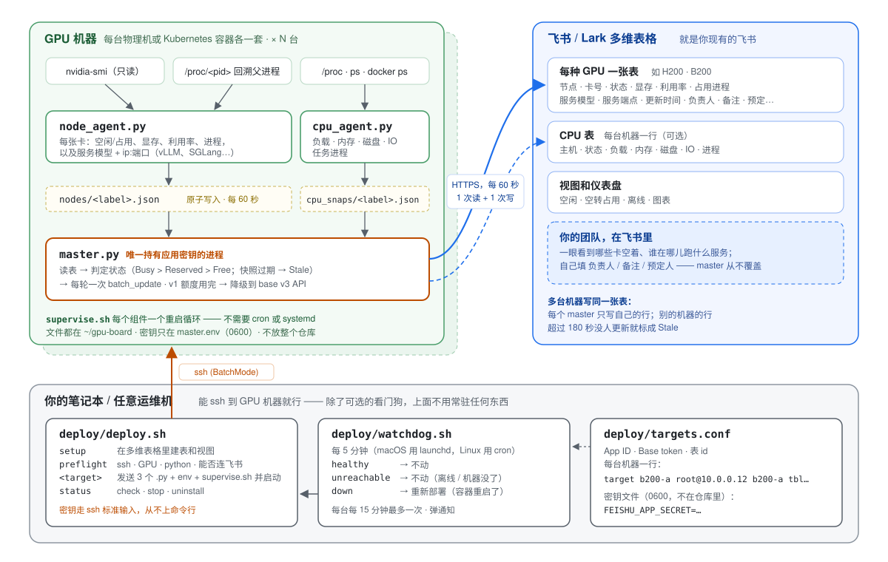
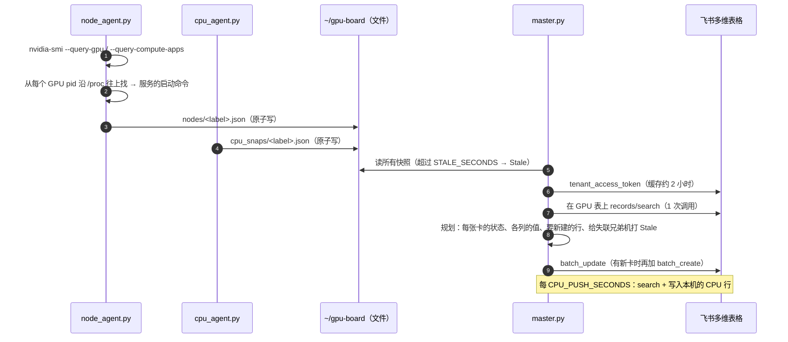

# 架构

[English](architecture.md) | **简体中文**

本文讲这块看板是怎么工作的，以及为什么这样设计。部署步骤见 [README](../README.zh-CN.md)。



## 目录

1. [组件](#组件)
2. [一轮刷新的完整过程](#一轮刷新的完整过程)
3. [状态规则](#状态规则)
4. [服务模型识别](#服务模型识别)
5. [多台机器共用一张表](#多台机器共用一张表)
6. [飞书 API 和配额](#飞书-api-和配额)
7. [生命周期：守护、部署、看门狗](#生命周期守护部署看门狗)
8. [安全设计](#安全设计)
9. [为什么这样设计](#为什么这样设计)
10. [其它部署形态](#其它部署形态)

## 组件

| 在哪儿 | 文件 | 作用 |
|---|---|---|
| 每台 GPU 机器 | `board/node_agent.py` | 用 `nvidia-smi` 给每张卡拍快照，再沿 `/proc` 回溯找出服务模型和端点。写 `nodes/<label>.json`。不联网，不持有凭证。 |
| 每台 GPU 机器 | `board/cpu_agent.py` | 整机快照：负载和 1 小时峰值、内存 %、磁盘 %、最忙那块盘的 IO %、docker 容器数、任务进程。写 `cpu_snaps/<label>.json`。不联网，不持有凭证。 |
| 每台 GPU 机器 | `board/master.py` | 读快照和表格，算出每张卡的状态，一次批量写回表格。唯一持有应用密钥的组件。 |
| 每台 GPU 机器 | `supervise.sh`（自动生成） | 每个组件一个重启循环，外加每小时裁剪一次日志。代替容器里通常没有的 cron 和 systemd。 |
| 你的笔记本 | `deploy/deploy.sh` | 通过 SSH 执行 `setup` / `preflight` / 部署 / `status` / `check` / `stop` / `uninstall`。 |
| 你的笔记本 | `deploy/watchdog.sh` | 每 5 分钟（launchd 或 cron）对每台机器跑一次 `check`，挂了的就重新部署。 |
| 任何地方 | `board/setup_tables.py` | 通过 API 创建或补全表格和视图（纯标准库，可重复执行）。 |

所有 Python 都只用标准库，需要 3.7 以上。机器上不 `pip install` 任何东西，除了三个 `.py` 文件，仓库里的其它东西都不会留在机器上。（`setup --via` 会把 `setup_tables.py` 作为临时文件执行，跑完就删。）

同一台机器上的三个进程只通过**同一个目录里的文件**交流。采集进程原子地写快照（先写 `tmp` 再 `rename`），所以 master 永远读不到写了一半的文件。它们之间没有共享的运行时状态，所以每个进程都可以单独崩溃、重启或升级。

## 一轮刷新的完整过程



一份快照长这样：

```json
{"node": "b200-a", "ts": 1760520000, "rows": [
  {"gpu": 0, "status": "Busy", "mem_used_mb": 162000, "mem_total_mb": 183359,
   "util": 97, "user_proc": "VLLM::Worker_TP0:4242",
   "model": "Qwen3-32B", "endpoint": "10.0.0.12:8000"}]}
```

master 把它映射成中文列名（`master.py` 里的 `FMAP`）。行按 `(节点, 卡号)` 对应。没有对应行的卡会自动新建一行，所以第一次部署后表格会自己填满。

master 也会替界面收拾残局。**完全空白**的行，就是有人在界面上手动点「+」留下的样子；它永远对不上任何一张卡，所以会被删掉，并在日志里记一笔。

只要一行里有任何内容，就绝不会被删，哪怕它缺 `节点` 或 `卡号`。如果整张表根本没有 `节点` 或 `卡号` 这一列（比如有人在界面上把列改了名），master 这一轮什么都不写，只在日志里说明原因；否则它会每轮都把所有卡当新卡重复建一遍。

## 状态规则

`master.py` 里的 `decide_status`，优先级从高到低：

| 状态 | 什么时候 |
|---|---|
| **Stale** | 本机快照比 `STALE_SECONDS`（180 秒）旧；或者对别的机器的行来说，已经这么久没人更新了 |
| **Busy** | 卡上有任何计算进程，**或者**显存占用 ≥ `FREE_MEM_MB`（2048 MB）。看显存是为了抓住 `nvidia-smi` 认不出归属的进程，比如别的容器里的 |
| **Reserved** | 填了 `预定人`，并且现在处于 `[预定开始, 预定结束 或开始那天的 23:59:59]` 之内 |
| **Free** | 其它情况 |

预定永远不会掩盖真实占用：被预定的卡上如果有人在算，显示 **Busy**，预定信息照样留着。预定时段过了、卡也空着，master 会清掉 `预定人` / `预定开始` / `预定结束`。Stale 的卡永远不会清预定，因为 master 没法确认这张卡是不是真空着。

有些预定只填了名字、没填开始时间。对这种预定，master 会把它第一次看到这条预定的时刻写进 `预定开始`。如果不这样锚定，「开始 = 现在」会每轮往后挪，这条预定就永远不会结束。「当天结束」按 `BOARD_UTC_OFFSET` 时区计算，`deploy.sh` 默认取执行部署的那台机器的时区。这很重要，因为容器里通常是 UTC。

master 只写表格里实际存在的列。它在启动时读一次列名，之后每次写入都按这个列表过滤。所以没有预定列、或者没有 `服务模型` / `服务端点` 列的表也能正常工作；否则只要写一个不存在的列，整批写入都会失败。

## 服务模型识别

`nvidia-smi --query-compute-apps` 报告的是 **worker** 进程的 PID。推理引擎会给 worker 改名（`VLLM::EngineCore`、`VLLM::Worker_TP0_EP0`、`sglang::scheduler_DP0_TP0`），所以 worker 的命令行里既没有模型名也没有端口。真正的启动命令在父进程链往上一到三跳的位置。对每个 GPU PID，`node_agent.py` 会：

1. 顺着 `/proc/<pid>/status` 里的 `PPid:` 往上走，最多 6 跳，并防住循环和半路退出的进程；
2. 停在第一个 `/proc/<pid>/cmdline` 里含有**启动命令特征**的祖先进程：`vllm serve`、`vllm.entrypoints`、`sglang serve`、`sglang.launch_server`、`lmdeploy serve`、`trtllm-serve`、`text-generation-launcher`。`SERVE_PATTERNS` 只会往这个列表里追加，不会替换；
3. 读模型名：先看 `--served-model-name` / `--model-name`，再看 `--model` / `--model-path` / `--model-id`，最后看位置参数（`vllm serve M`、`lmdeploy serve api_server M`、`trtllm-serve M`）。文件路径只保留最后一段，但像 `Qwen/Qwen3-8B` 这样的 Hugging Face 仓库名保持完整；
4. 读 `--host` / `--server-name` / `--hostname` 和 `--port` / `--server-port`，没写就用引擎默认值：vLLM 8000、SGLang 30000、lmdeploy 23333、TGI 3000、`trtllm-serve` 为 `localhost:8000`。vLLM 和 SGLang 在线上的真实启动命令上验证过，另外三种是尽力解析；
5. 拼出端点。`0.0.0.0` 或没写 host，就换成**本机地址**（内核访问 `SERVE_IP_PROBE` 时会用的源 IP，通过一次 UDP `connect()` 得到，不发任何包）。监听回环地址的写成 `127.0.0.1:8000 (local only)`，免得有人从别的机器去调。

每个特征都必须带上**启动动词**。只写 `sglang` 的话，第 0 跳就会命中 `sglang::scheduler…` 这种进程标题。用 Ray 驱动 SGLang 做 rollout 的强化学习任务恰好就是这个形态，它会被当成一个对外提供服务的模型端点公布出去，而实际上谁也没在服务。测试里专门钉住了这个情况。

张量并行的服务在多张卡上有很多个 worker。查询按 PID 缓存，每张卡上同一个端点只列一次。

## 多台机器共用一张表

常见的布局是一种 GPU 一张表，多台机器写同一张表。每台机器的 master 只有自己节点的快照，所以对表里的任意一行，它只会遇到三种情况：

- **自己的节点，快照新鲜**：全部写；
- **自己的节点，快照过期**（自己的采集进程挂了）：写 `状态 = Stale` 和快照里最后一次的值，但不写 `更新时间`，让它继续表示最后一次真正看到这张卡的时间；
- **别的节点的行**：只要它的 `更新时间` 比 `STALE_SECONDS` 新，就不碰。一旦更旧，只写 `状态 = Stale`，这样 `更新时间` 仍表示那台机器最后一次真正被看到的时间。

这不需要任何协调、选主或共享存储。两台都健康时，两个 master 永远不会写同一行。一台机器挂了，任何一台还活着的兄弟机会在 `STALE_SECONDS` 加一个周期之内把它标出来。CPU 表遵循同样的规则，阈值是 `CPU_STALE_SECONDS`（900 秒）。

局限在于：如果一台机器**独占**一张表，而它整个挂了（比如容器重启），就没有别人能替它打标。它的行会保持最后的值，只有越来越旧的 `更新时间` 能看出问题。看门狗就是为这种情况准备的。如果你希望机器之间互相作证，就让它们写同一张表。

## 飞书 API 和配额

每个 master 每轮：一次 `records/search` 读取，加一次 `batch_update`（出现新卡时再加一次 `batch_create`）。`tenant_access_token` 缓存约 2 小时。60 秒一轮的话每月约 9 万次调用，CPU 表按 300 秒一轮再加约 1.7 万次。

飞书的每月 OpenAPI 额度是**按接口方法**分别计算的。如果 bitable v1 的写接口额度用完了（错误码 `99991403`），master 会降级运行，而不是整块看板冻住：

1. **读取**依次退到：v1 `search` → v1 列表 `GET` → base v3 列式列表。v3 会完整分页，因为只读到一部分的话，额度恢复后会把漏掉的卡重复建一遍。
2. **状态写入**改走 base v3 的 `batch_update`。这个接口只能把**同一个**补丁应用到很多条记录上，所以卡片按 `(状态, 是否清预定, 是否刷新时间)` 分组，每组一次调用。全量刷新每 `SWEEP_SECONDS` 一次，默认每轮都刷：共用一张表的 master 之间靠 `更新时间` 互相判断死活，降级模式下它也必须保持新鲜。这每轮只多几次调用。如果一张表只有一个 master，可以设成 1800，只写状态变化，外加每半小时一次「我还活着」。给别的机器打 Stale 时永远不改 `更新时间`。
3. **单卡明细**（`显存` / `利用率` / `占用进程` / 模型 / 端点）走单条记录的 v3 补丁，只写进程集合、模型或端点有变化的卡。每轮最多 `DETAIL_PATCH_LIMIT` 条，没写完的留到下一轮。

`FEISHU_PREFER_V3=1` 会让 v3 成为主通道，完整的 v1 写入只每 `DETAIL_SECONDS` 跑一次，适合 v1 额度紧张的租户。这些参数（以及 `CPU_STALE_SECONDS`）只要在 `targets.conf` 里设了，`deploy.sh` 就会透传进 `master.env`。

## 生命周期：守护、部署、看门狗

**在机器上。** `deploy.sh` 通过 `ssh … 'bash -s'` 发送一段 bash 脚本。脚本写出三个 `.py` 文件（以 gzip+base64 内嵌）、`agent.env`、`master.env`（0600）和 `supervise.sh`。接着它停掉上一次安装的守护进程，停之前先核对该 PID 的命令行确实是*这次安装目录下*的 `supervise.sh`。然后用 `setsid nohup` 启动新的守护进程，让它在 SSH 断开后继续活着。最后它等 master 跑完第一轮，报告 `[name] OK` 或 `[name] FAIL`，并附上日志末尾。升级就是再部署一次。

`supervise.sh` 给每个组件跑一个 `while true; do <组件>; sleep 10; done` 循环。崩一次最多耽误 10 秒；master 比采集进程晚 5 秒启动，好让它第一轮就读到新鲜的快照。日志超过 5 MB 时每小时裁剪一次。

**跨重启。** 容器重启会清掉进程，在 overlay 根文件系统上往往连文件也一起没了。这种机器上没有任何东西能把它们拉起来，所以看门狗只能跑在别处。`deploy.sh <t> check` 对每台机器给出三种结果之一：

| 结果 | 含义 | 看门狗的动作 |
|---|---|---|
| `healthy`（退出码 0） | 守护进程活着，**并且**节点快照和 master 日志都比 `FRESH`（2 × `CYCLE_SECONDS` + 180，默认 300 秒）新 | 不动 |
| `down`（退出码 1） | SSH 能连上，但进程死了或卡住了 | 重新部署，每台每 `BACKOFF`（15 分钟）最多一次 |
| `unreachable`（退出码 2） | SSH 连不上：笔记本离线，或机器没了 | 不动，因为从这里修不了 |

看门狗会加锁，保证不会两次同时运行。它只在状态变化时写日志，重新部署时会弹桌面通知。它运行的是工具包的一份*副本*（macOS 上在 `~/Library/Application Support/gpu-board-watchdog`，Linux 上在 `~/.local/share/gpu-board-watchdog`），每次部署成功都会刷新这份副本。这样它恢复的永远是你最后一次部署的代码，launchd 也不需要访问 `~/Desktop` 或 `~/Documents` 的权限。

如果你能改容器的启动配置，可以不靠看门狗、让看板自己恢复。把 `REMOTE_DIR` 放在持久卷上，部署一次，然后把下面这行加进容器的启动命令：

```bash
setsid nohup "$HOME/gpu-board/supervise.sh" >/dev/null 2>&1 </dev/null & echo $! > "$HOME/gpu-board/supervise.pid"
```

两个细节都不能省。`check`、`stop` 和重新部署都是通过 `supervise.pid` 找到正在运行的这套进程的，并且会核对它的命令行里是否有绝对路径 `…/gpu-board/supervise.sh`。

`check` 的输出来自机器，所以笔记本用严格的正则表达式解析它，从不 `eval`。即使某台机器被攻破，也没法在运行看门狗的那台机器上执行代码。

## 安全设计

| 关注点 | 怎么处理 |
|---|---|
| 笔记本上的应用密钥 | 只在一个文件里（`SECRET_FILE`，权限 600），不在仓库里；`targets.conf` 里没有密钥 |
| 传输中的应用密钥 | 夹在部署脚本里走 SSH **标准输入**，从不出现在 `ps` 能看到的命令行上 |
| 机器上的应用密钥 | 只在 `master.env`（0600）里，只有 master 读；采集进程的 `agent.env` 里没有密钥 |
| 采集进程能做什么 | 只读：`nvidia-smi` 查询、`/proc/<pid>/{cmdline,status}`、`ps`、`docker ps -q`；不发信号、不 attach |
| 工具会停掉什么 | 只停它自己的守护进程，而且先核对该 PID 的命令行是 `<REMOTE_DIR>/supervise.sh` |
| 什么会出现在看板上 | `进程名:pid`、模型名和端点，从不出现完整命令行，所以 `--api-key …` 不会上表 |
| 飞书权限 | 只要 `bitable:app`，而且只能访问明确把应用加进去的多维表格 |

## 为什么这样设计

这块看板经历了三种架构，每一种的失败方式都决定了下一种的样子。

1. **中心化 SSH 轮询。** 笔记本或虚拟机上一个进程，通过多路复用的 SSH 在每台机器上跑 `nvidia-smi`，再写表格。很简单，但需要一台常开、握有所有机器 SSH 密钥的机器，而且那台机器一睡眠、或者网络路径一变就不行了。
2. **每个节点自己写看板。** 不再需要中心机器，但 48 个节点各自轮询 API，一个月烧掉约 600 万次调用，把飞书应用的每月额度用光了。整块看板一直冻到下个月 1 号。而且应用密钥要放在每个节点上。
3. **采集进程 + 批量写入的 master（现在的方案）。** 采集进程在本地运行、只读、不持有密钥。master 每轮一次读取加一次批量写入，和卡的数量无关。一张表一个 master（共享文件系统）时，48 个节点的调用量从每月约 600 万降到约 10 万。每台机器一个 master（容器场景）时，每台每月约 10 万次，几台机器完全没问题；如果有几十台，建议用下面的共享文件系统布局。v1→v3 的降级路径就是因为第 2 种方案那次额度事故才加的。

每台机器各跑一个 master，是迁到 Kubernetes 容器之后才有的。容器之间没有共享文件系统，也没有 cron 和 systemd，原来「一个 master 读所有人的快照文件」的布局就不适用了。让每台机器自带 master，再加上共用表格时的 Stale 规则，最后一点跨机器的依赖也去掉了。

## 其它部署形态

- **共享文件系统，单个 master。** 如果节点之间挂了同一个 NFS 或 GPFS，把每个节点的 `SNAP_DIR` 指向上面的同一个目录，只在一个节点上跑 `master.py`。它本来就会读 `SNAP_DIR` 里所有的 `*.json` 并全部写入，这就是最初 48 节点时的布局。`deploy.sh` 不自动化这种形态，需要用同样的环境变量手动搭。
- **所有机器一张表。** 让所有 target 指向同一个表 id，`节点` 列会把各台机器的行区分开。
- **Lark（国际版）。** 设 `FEISHU_BASE_URL=https://open.larksuite.com`，API 完全一样。
